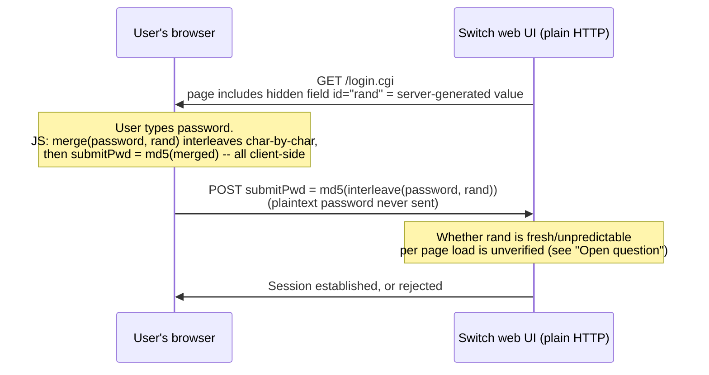

# Web UI login — client-side challenge scheme

Found by extracting and reading the firmware's own `login.js` (gzip-embedded
web asset, see [`FIRMWARE-FORMAT.md`](FIRMWARE-FORMAT.md)). This documents a
**factual interoperability/security observation** about how the switch's own
web UI protects (or doesn't protect) the admin password in transit — not a
copy of the vendor's JS. Only the two short, directly-relevant functions are
quoted below (a trivial character-interleave and the call site), to document
the algorithm precisely rather than paraphrase it ambiguously; the full file
is not reproduced or committed anywhere in this repository.

## The scheme

The login page embeds a server-generated value in a hidden field
(`id="rand"`) alongside the password field. On submit, client-side JS:

```js
function merge(str1, str2){
    var arr1 = str1.split("");
    var arr2 = str2.split("");
    var result = "";
    var index1 = 0;
    var index2 = 0;
    while((index1 < arr1.length) || (index2 < arr2.length)){
        if(index1 < arr1.length){ result += arr1[index1]; index1++; }
        if(index2 < arr2.length){ result += arr2[index2]; index2++; }
    }
    return result;
}

function encryptPwd(){
    var password = document.getElementById("password").value;
    var randNum  = document.getElementById("rand").value;
    var resultStr = merge(password,randNum);
    document.getElementById("submitPwd").value = md5(resultStr);
}
```

`merge()` **interleaves** the two strings character-by-character
(`p0,r0,p1,r1,p2,r2,...`, tail of the longer string appended once the
shorter one runs out) rather than concatenating them. The interleaved
string is then MD5-hashed, and only the hash (`submitPwd`) is sent to the
switch — the plaintext password field itself is not submitted.



This is a client-side obfuscation step, not a protocol: there is no
server-held secret beyond `rand` itself, and anyone who observes one
`(rand, md5(interleave(password, rand)))` pair on the wire (trivial over
plain HTTP, see below) can attack that pair offline exactly as if the raw
MD5 of the password had been sent.

## Why this matters

- This is a **client-side-only** obfuscation scheme, not a cryptographic
  challenge-response protocol: there is no server-held secret or
  session-bound key involved beyond the `rand` value itself, and MD5 is fast
  to brute-force offline once a (rand, hash) pair is captured.
- Security of the scheme rests entirely on (a) `rand` being unpredictable
  and single-use, and (b) the channel not being observable by a
  man-in-the-middle, since the web UI runs over plain HTTP (not HTTPS) per
  NETGEAR's own documentation for this switch family.
- This is consistent with — and likely the same general design era as — the
  **predictable session ID** and **plaintext password in NSDP broadcast**
  weaknesses documented in the 2016 Westermann disclosure (see
  [`research.md`](research.md)); whether `rand` here is itself predictable
  (e.g., derived from uptime, a weak PRNG, or a small reused pool) has not
  been checked against the live device yet and would need to be observed
  from actual page loads once the switch is reachable.
- Practical implication for this project's home-network segmentation goal:
  treat the web UI as **management-plane traffic to confine to a trusted
  VLAN**, the same conclusion [`NSDP-PROTOCOL.md`](NSDP-PROTOCOL.md) reaches
  for NSDP — this scheme is not a reason to trust the web UI across an
  untrusted boundary.

## Open question

Whether `rand` is generated fresh per page load and how (uptime counter?
system RNG?) is not yet determined — would require observing the actual
`login.cgi`/equivalent page source against the live device, not just the
static JS.
